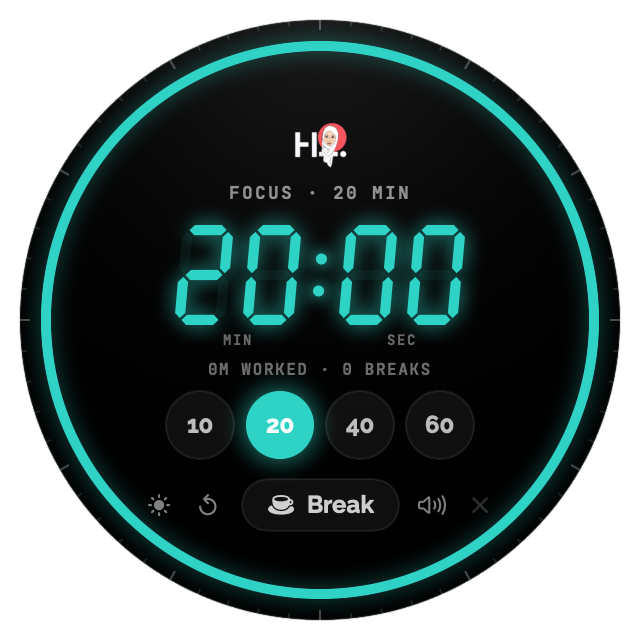
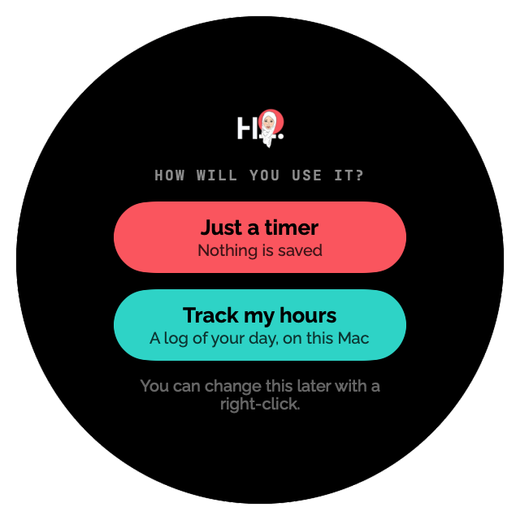

# Hanadi Timer

[العربية](README.ar.md)

A round LED desk timer for your Mac that floats above your other windows. Tap it to count up from 00:00, or pick 10, 20, 40 or 60 minutes. Take breaks without losing your work time.

<p align="center">
  
  
</p>

## Two ways to use it

The first time it opens, the timer asks:

- **Just a timer.** Count up, countdowns, breaks and sounds. Nothing is saved.
- **Track my hours.** The same, plus a log of your day: today's total on the dial, every work stretch and break with its times, a history kept on your Mac, and **Export my hours…** as a spreadsheet file (CSV) for Numbers or Excel. No account needed.

You can switch any time: right-click the timer → **Use as**.

## Features

- **Count up or count down.** Tap the digits to count up; tap 10 / 20 / 40 / 60 for a focus countdown. Seconds always show (H:MM:SS past an hour).
- **Breaks that don't reset your work.** Break pauses your work timer; "Back to work" carries on where you stopped.
- **Knows when you're away.** Sleep, lock or 15 minutes without input pauses work at your last touch, then asks what to do with that time.
- **Floats on top**, on every desktop. Three sizes, drag to move, menu bar icon with the live time, ⌃⌥T to show or hide.
- **Motivating sounds** and milestone cheers (every 15 minutes, halfway, last minute).
- **Arabic and English**, following your Mac's language, or pick one in the right-click menu.

Needs macOS 15 (Sequoia) or later. No admin rights, accounts or passwords.

## Install

Pick one of three ways.

### 1. With your AI assistant

This needs an assistant that can run commands on your Mac, such as the Claude desktop app (Claude Code) or Gemini CLI. Chat-only assistants in a web browser can't install apps; use the download below instead. Paste this:

> Install Hanadi Timer from https://github.com/Hanadi-designs/hanadi-timer on my Mac, following its INSTALL-WITH-AI.md.

### 2. Download

1. Download **Hanadi-Timer-macOS.zip** from the [latest release](https://github.com/Hanadi-designs/hanadi-timer/releases/latest) and double-click it.
2. Drag **Hanadi Timer** into your **Applications** folder.
3. The first time only: **right-click** the app → **Open** → **Open**. If macOS still says it can't be opened, go to **System Settings → Privacy & Security**, scroll down and click **Open Anyway**.

macOS asks this because the app isn't notarized by Apple: it's a free personal project, not a paid Apple developer account. Building it yourself (below) avoids the prompt.

### 3. Build it yourself

Needs the free Xcode Command Line Tools (`xcode-select --install`).

```bash
git clone https://github.com/Hanadi-designs/hanadi-timer hanadi-timer
cd hanadi-timer
./build.sh
open ~/Applications/"Hanadi Timer.app"
```

The app is built into `~/Applications`. Find it later with Spotlight: **Hanadi Timer**.

## Using it

| Do this | To |
|---|---|
| Tap the digits | Start counting up, pause, resume |
| Tap 10 / 20 / 40 / 60 | Start a focus countdown |
| Break / Back to work | Pause work for a break, then carry on |
| Drag the edge | Move it |
| Corner handle, pinch, or right-click → Size | Resize |
| Right-click | Use as, today's log, export, language, stay on top, open at login, quit |
| ⌃⌥T or the menu bar icon | Show or hide |

## Files on your Mac

- With **Track my hours**: history in `~/Library/Application Support/Hanadi Timer/work-log.jsonl` (one line per stretch)
- Settings: the app's preferences (`com.hanadialotaibi.timer`)

## Optional extras

### Send your hours to Notion (advanced)

Only with **Track my hours**, and only if you use Notion. Each work stretch and break becomes a row in a Notion "Work log".

1. Open https://app.notion.com/developers/connections → **Build** › **Internal connections** → **Create a new connection**. Name it, keep **API token** as the authentication method → **Create connection**.
2. On the **Configuration** tab, copy the token. On the **Content access** tab → **Edit access** → pick the page for your log.
3. Right-click the timer → **Send to Notion (advanced)…** → paste the token. It is kept in your Mac's Keychain only. Never paste it into a chat.
4. In Notion, open that page → **•••** → **Copy link**, paste it into the timer's second field → **Save**. A "Work log" database is created in that page (or paste the link of an existing Work log).

After you update the app, macOS may ask once whether Hanadi Timer can use its Notion token. Enter your Mac password and click **Always Allow**.

## License

The code is under the [MIT License](LICENSE).

**Brand assets:** the name "Hanadi Timer", the Hanadi Alotaibi logo and the portrait mark belong to Hanadi Alotaibi and are not covered by the MIT License. If you publish your own version, give it your own name and logo. The fonts, [Raleway](assets/fonts/Raleway/OFL.txt) and [JetBrains Mono](assets/fonts/JetBrainsMono/OFL.txt), keep their own SIL Open Font License.

Design: Hanadi Alotaibi.
